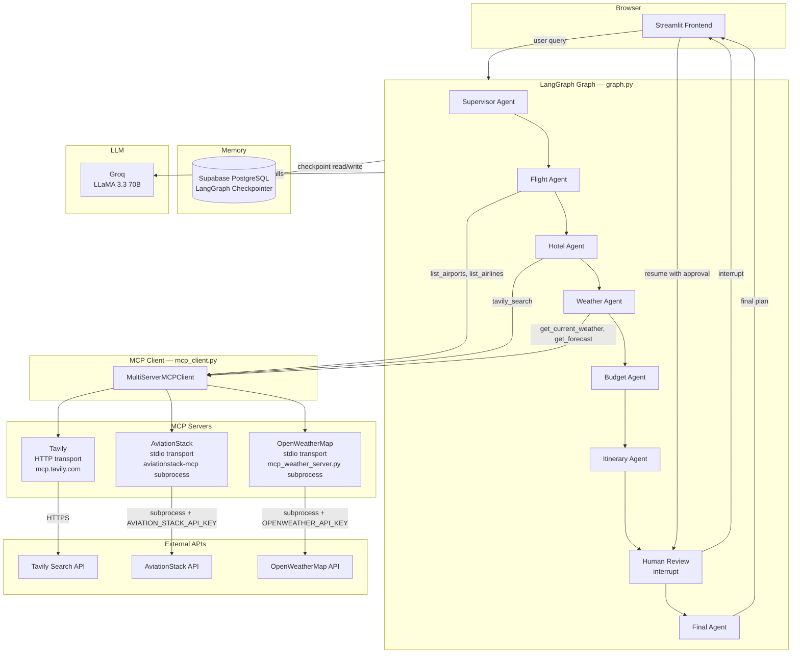
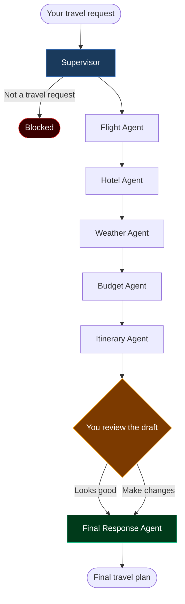
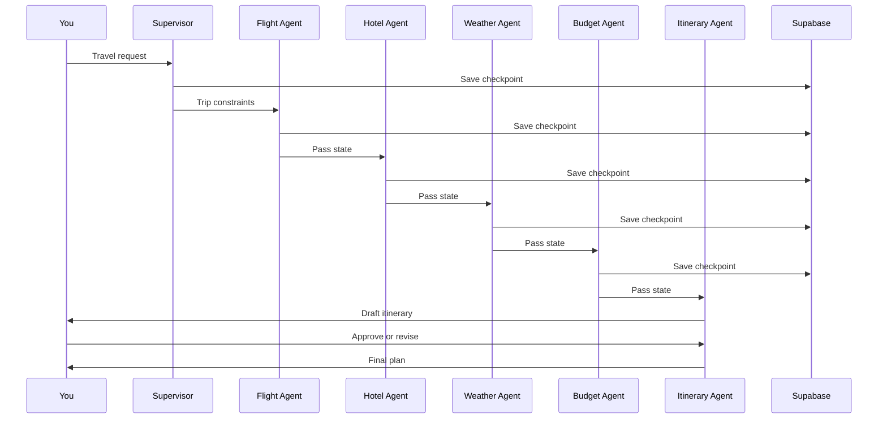

# GoBeyond — Multi-Agent AI Travel Planner

A multi-agent travel planning system built with LangGraph. You describe a trip, and eight agents work through it together — pulling real flight data, hotel options, and weather info before handing you a complete day-by-day plan that you review before it's finalized.


---

## Architecture

This diagram shows every component in the system and how they connect — from the browser all the way through to the external APIs.



---

## How MCP communication works

The app never calls external APIs directly. Instead, [mcp_client.py](mcp_client.py) creates a `MultiServerMCPClient` that manages three MCP server connections:

| Server | Transport | What it does |
|--------|-----------|-------------|
| **Tavily** | Streamable HTTP | Sends search queries to `mcp.tavily.com` over HTTPS |
| **AviationStack** | stdio | Spawns `aviationstack-mcp` as a subprocess, communicates via stdin/stdout |
| **OpenWeatherMap** | stdio | Spawns `mcp_weather_server.py` as a subprocess, communicates via stdin/stdout |

When a user submits a query, here is the exact sequence:

1. Streamlit calls `app.invoke()` on the LangGraph graph
2. The graph saves a checkpoint to Supabase PostgreSQL before each node runs
3. The supervisor sends the query to Groq (LLaMA 3.3 70B) to decide which agents run
4. Flight agent calls `list_airports()` and `list_airlines()` — these go through `mcp_client.py` → AviationStack subprocess → AviationStack REST API
5. Hotel agent calls `tavily_search()` — goes through `mcp_client.py` → Tavily HTTP MCP → Tavily Search API
6. Weather agent calls `current_weather()` and `forecast()` — goes through `mcp_client.py` → weather subprocess → OpenWeatherMap REST API
7. Budget and Itinerary agents use Groq only — no external API calls
8. The graph hits an `interrupt` at the human review node and returns control to Streamlit
9. You approve or request changes in the UI
10. Streamlit calls `app.invoke(Command(resume=...))` to continue the graph
11. Final agent writes the finished plan using Groq
12. The complete plan is shown in the UI and saved as a Markdown file

---




The supervisor first checks if the request makes sense. If it does, it figures out which agents are needed and passes the job along. Each agent adds its piece — flights, hotels, weather, budget — and the itinerary agent puts it all together into a draft. You then review that draft, approve it or give feedback, and the final agent writes up the finished plan.

Conversation history is stored in Supabase PostgreSQL so your session continues even if you close the tab.

---

## Agent breakdown

| Agent | What it does |
|-------|-------------|
| Supervisor | Validates the request, picks which agents to run, extracts trip details |
| Flight Agent | Queries AviationStack for airport and airline data, generates flight guidance |
| Hotel Agent | Searches hotels and neighbourhoods via Tavily web search |
| Weather Agent | Gets current weather and a 5-day forecast from OpenWeatherMap |
| Budget Agent | Checks whether the plan fits the budget and flags any risks |
| Itinerary Agent | Puts everything together into a day-by-day travel plan |
| Human Approval | Pauses and waits for you to approve or revise the draft |
| Final Response | Writes the polished final plan based on your decision |

---

## Data flow



---

## Tech stack

| Layer | Tech |
|-------|------|
| Agent framework | LangGraph |
| LLM | Groq — LLaMA 3.3 70B |
| Memory | Supabase PostgreSQL |
| Web search | Tavily MCP |
| Flight data | AviationStack MCP |
| Weather | OpenWeatherMap MCP |
| Frontend | Streamlit |

---

## Project structure

```
gobeyond/
├── config.py               env vars and LLM setup
├── state.py                shared state definition
├── agents.py               all eight agent functions
├── graph.py                graph wiring and Supabase checkpointer
├── mcp_client.py           connects to Tavily, AviationStack, and weather MCP
├── mcp_weather_server.py   local weather MCP server
├── main.py                 CLI entry point
├── frontend.py             Streamlit app
├── tools/
│   ├── flight_tool.py      direct AviationStack REST helper
│   └── tavily_tool.py      direct Tavily search helper
├── .env.example            env template
└── requirements.txt
```

---

## Setup

### 1. Clone the repo

```bash
git clone https://github.com/YadavAkhileshh/GoBeyond.git
cd GoBeyond
```

### 2. Create and activate a virtual environment

```bash
python -m venv langgraph_env
langgraph_env\Scripts\activate       # Windows
source langgraph_env/bin/activate    # macOS / Linux
```

### 3. Install dependencies

```bash
pip install -r requirements.txt
```

### 4. Set up your `.env`

```bash
cp .env.example .env
```

Fill in your keys. The app needs Groq, Tavily, AviationStack, OpenWeatherMap, and a Supabase database URL.

### 5. Set up Supabase

Create a project at [supabase.com](https://supabase.com), then go to **Settings → Database → Connection string** and copy the Transaction pooler URL (port 6543). Paste it as `DATABASE_URL` in your `.env`. LangGraph creates the tables on first run.

### 6. Set up the AviationStack MCP server

```bash
git clone https://github.com/Pradumnasaraf/aviationstack-mcp.git
cd aviationstack-mcp
pip install uv
uv sync
cd ..
```

---

## Run

```bash
streamlit run frontend.py
```

Or from the terminal:

```bash
python main.py
python main.py --query "7-day Japan trip under 2 lakhs"
```

---

## API keys you need

| Service | Link |
|---------|------|
| Groq | https://console.groq.com |
| Tavily | https://tavily.com |
| AviationStack | https://aviationstack.com |
| OpenWeatherMap | https://openweathermap.org/api |
| Supabase | https://supabase.com |

---

## License

MIT
